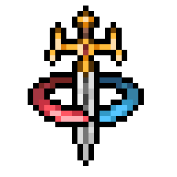

<p align="center"></p>

# Tibia Foundry

*Tibia Foundry - All your Tibia-Tools for [TibiaWiki](https://tibia.fandom.com/wiki/Main_Page)*

**Tibia Foundry** is an independent desktop toolkit for Tibia fansite administrators, wiki editors, artists, and content creators. Explore official game assets, generate graphics, render outfits and creatures, create maps, process media, and prepare resources for Tibia community websites.

It reads the official files of your installed Tibia client — it never changes them — and turns them into material for [TibiaWiki](https://tibia.fandom.com/), fansites, guides and galleries, with your name as creator embedded in every image.

### Who it is for

* **Wiki editors**: ready-to-paste `{{Infobox Object}}` markup, images, animated GIFs, item IDs, creature and NPC data, NPC trade tables and house images for articles.
* **Fansite administrators**: consistent galleries, item databases, map references and update articles ("what changed in this client version").
* **Artists and graphic designers**: transparent sprites, pixel-exact enlargements, sprite sheets and the client's interface artwork as references.
* **Guide writers and content creators**: map images, location references, sounds, and correctly credited media.

### The toolkit at a glance

| Group | Tools | Typical fansite use |
|---|---|---|
| **Start** | Home | What Tibia Foundry does, every tool by category, recent tools and exports, common workflows |
| **Content Production** | Asset Library, Content Studio | A searchable library of every resource (collections, tags, duplicates, versions); reusable projects that render creature, outfit and item galleries and publish them for any website |
| **Graphics & Sprites** | Appearances (with the Outfitter and the Wiki infobox), Extract Sprites, Advanced Tools | Item, creature, outfit and effect GIFs with fansite export presets; TibiaWiki item infoboxes; transparent sprites; sprite sheets for galleries |
| **Game Data** | Static Data, Item Catalog, Compare Files | Creature, boss, achievement, house and quest data; item names and IDs; what changed between client versions |
| **Maps & Houses** | Map Tools, House Images | Map images, areas and NPC positions for guides; a picture of every house for house articles |
| **Sound & Media** | Sounds, File Metadata | The client's sounds and music; creator, copyright and keywords of published files |
| **Asset Management** | Assets Editor, RCC Editor, Client Converter | Inspecting and preparing official assets, interface artwork, classic-format copies for historical comparisons |
| **Client Library** | Clients, Client Installation Rebuilder | Keeping every official client version for historical reference and asset access |
| **Utilities** | Scripts | Batch renaming, image conversion and resizing (nearest-neighbor), checksums, backups, audits |
| **Application** | Settings, Compatibility, Diagnostics, About | Preferences, compatibility after a Tibia update, logs, credits |

### New in 9.0: TibiaWiki infoboxes, safer saving, one version source

* the **TibiaWiki Infobox Exporter** ([docs/26_TibiaWiki_Infobox_Exporter.md](docs/26_TibiaWiki_Infobox_Exporter.md)), Appearances → *Wiki infobox*: select an object and get `{{Infobox Object}}` markup filled from the client's own data – ID, names, flavortext (9.0.1), slot, level and vocations, hands and weapon type, imbuement slots, upgrade class, every object flag, light and map colour, stackable/marketable and the complete NPC trade (`npcvalue`, `npcprice`, `buyfrom`, `sellto`). Each value shows where it came from; values the client does not contain (implemented, weight, attack, armor…) are never guessed and are listed for you to fill in. Edit, copy, save as `.txt`, or save one file per selected object;
* **safer saving**: settings, catalogs, manifests and other documents are flushed to the disk before they replace the old file; a backup "move" to another drive keeps the original until the copy is verified;
* **one version source** (`src/Directory.Build.props`): the program, installer, packages and website all say the same version (**9.0.3** now);
* fixes: a numeric field could step more than once per click after a theme switch; a test assumed one particular client build.

### New in 8.8: the Asset Library and Content Studio

* the **Asset Library** ([docs/24_Asset_Library_and_Content_Studio.md](docs/24_Asset_Library_and_Content_Studio.md)): a local SQLite index of your images, animations and sounds. Folders are indexed where they are and rescanned incrementally; **every export of every tool is added automatically**. Thumbnails, search and filters (name, ID, category, client version, source, format, tags, creator, dates, size, animation, export status), metadata and custom fields, your own categories, collections (export and import), related assets, versions of changed files, duplicate detection (identical files, the same graphic at another size, visually similar images – nothing is ever deleted), integrity check, backup and restore;
* **Content Studio**: reusable **content projects** (creature gallery, outfit gallery, item image collection, map references, update resources, wiki image preparation, custom export), a **workflow builder** that combines steps without programming, a **background processing queue** (progress, cancellation, retry, error details, history), **publishing profiles** for any website, self-contained **HTML galleries**, contact and comparison sheets, JSON/CSV/Markdown manifests, text snippets and ZIP packages. Runs are staged and moved into place only when complete;
* integrations: Static Data → *Gallery of the list…*, Compare Files → *Visual gallery…*, Asset Library → *Create a project…*;
* clearer screens: Home's cards share one height, the Clients page is organized in cards with labeled details, the item-import confirmation and setup step 2 are structured, and long dialog lists scroll inside their section.

### New in 8.7: the fansite toolkit

* a **Home dashboard** ([docs/23_Fansite_Toolkit.md](docs/23_Fansite_Toolkit.md)): the toolkit's purpose, quick access to every tool by category, recently used tools, recent exports (click to show the file), the client in use, and step-by-step fansite workflows;
* **fansite export presets** for animated GIFs (Appearances → Export): *TibiaWiki image*, *Creature gallery*, *Outfit gallery*, *Item icon*, *Article illustration* and *High-resolution reference*. A preset only fills in the options; every option stays adjustable, and the selector shows *Custom* as soon as you change one;
* **pixel-exact enlargement** of GIFs (1×–8×, nearest-neighbor: no blur, no new colors, transparency kept); enlarged files end in `_2x`, `_3x`…;
* **organized output**: automatically named GIFs can be sorted into `Objects`, `Outfits`, `Effects` and `Missiles` folders;
* the navigation is **grouped by task** (Graphics & Sprites, Game Data, Maps & Houses, Sound & Media, Asset Management, Client Library, Utilities, Application); every tool is still there, and your remembered start page still opens.

### Editing and converting

* the **Assets Editor** inspects and edits the client's objects, outfits, effects and missiles with their sprites, exports images, and saves a validated copy (never the installed client);
* the **RCC Editor** opens, previews, extracts and rebuilds Qt resource files such as `graphics_resources.rcc` — the client's interface artwork, icons and backgrounds;
* the **Client Converter** writes the official modern assets as a classic `Tibia.dat` and `Tibia.spr` (Client 11, Tibia 10.98 layouts) for historical comparisons and legacy-format viewers, and identifies legacy files found in old client archives;
* **Utilities → Scripts** has 12 file utilities (duplicates, comparisons, renaming, checksums, image conversion and resizing, archives, backups, audits). Each previews its changes and asks before applying them.

New in 6.0:

* **Appearance & Themes**: your own color themes with live preview, readability warnings and *Restore original appearance*;
* **one output folder**, `Documents\Tibia_Foundry`, with a subfolder for each kind of output (it follows a Documents folder moved to OneDrive or another drive);
* **"✓ Saved to <file>"** after every export: click the path to open File Explorer with the file selected;
* a **Diagnostics** page: running and recent operations, process measurements, a searchable log, a self-check and a privacy-safe diagnostics report;
* a **tool registry**: every tool is described by a manifest (capabilities, dependencies, settings), so new tools plug into the same infrastructure ([docs/16_Adding_a_Tool.md](docs/16_Adding_a_Tool.md)).

New in 7.0:

* **Locate any client file**: every file and folder Tibia Foundry reads from the client can be pointed elsewhere, from the Compatibility page (*Locate…*) or Settings, separately for the live client and the test server ([docs/18_Client_Locations.md](docs/18_Client_Locations.md));
* the **Item Catalog**: item names and IDs from the client, TibiaWiki, lists, CSV and third-party `items.xml`/`items.otb` item files (always labeled unverified), kept apart by source and identifier type, with conflict review, comparisons between sources and catalogs, coverage, and exports to CSV, JSON, name lists and Excel ([docs/17_Item_Catalog.md](docs/17_Item_Catalog.md));

New in 8.7 — the fansite toolkit ([docs/23_Fansite_Toolkit.md](docs/23_Fansite_Toolkit.md)):

* a **Home dashboard**: every tool by category with what it is for, recently used tools, recent exports, the client in use, step-by-step workflows and links to TibiaWiki and the official fansites;
* the **navigation grouped by task** (Graphics & Sprites, Game Data, Maps & Houses, Sound & Media, Asset Management, Client Library, Utilities, Application);
* **GIF export presets** (TibiaWiki image, Creature gallery, Outfit gallery, Item icon, Article illustration, High-resolution reference), **pixel-exact enlargement** from 1× to 8×, and optional Objects/Outfits/Effects/Missiles folders. No tool was removed.

New in 8.6:

* **File Metadata** (Sound & Media): view, edit, compare and batch-edit the metadata of images (EXIF, XMP, IPTC), audio and video tags, Word/Excel/PowerPoint properties, EPUB books, SVG drawings and ZIP comments; PDFs, programs, other archives, other image formats and Tibia client files are read. Batch operations with a preview, presets, CSV/JSON reports, and safe saving: every save is written to a copy, read back and verified, optionally backed up, and never leaves a file half-written ([docs/22_File_Metadata.md](docs/22_File_Metadata.md));
* the **Default Live Client** (`%LOCALAPPDATA%\Tibia\packages\Tibia`) and **Default Test Client** (`…\TibiaExternal`) are recognized by name in setup, with their real state (available, incomplete, not installed…);
* redesigned **setup dialogs** — the archive question and the summary are organized in sections with copyable paths — and clearer messages everywhere: a *Copy* button, resizable boxes, and "1 file / 3 files" instead of "file(s)" ([V8.6.0_CHANGELOG_AND_AUDIT.md](V8.6.0_CHANGELOG_AND_AUDIT.md)).

New in 8.5:

* a redesigned **archive confirmation**: the client and version in the title, files, archive size and new disk usage at a glance, personal data in its own section (*Include personal data* recalculates the figures on the spot), and every category — archived, left out or unreadable — under *File details*;
* *Check for changes → Archive…* no longer reads every file of the client twice; clearer rebuild and error messages;
* safer everyday operations: closing while an operation runs asks first, Esc on an import question cancels, no output can go into a Tibia client folder, and importing or resetting settings never moves the client archive (all fixes: [V8.5.0_CHANGELOG_AND_AUDIT.md](V8.5.0_CHANGELOG_AND_AUDIT.md)).

New in 8.0:

* **complete client archives**: archive a whole installation (every file, empty folders, times; personal data left out visibly by default), as space-efficient revisions that share identical files or as independent copies; each revision is labeled honestly as complete, content-complete or incomplete;
* **client folders from anywhere**: find installations, or browse to any client folder, copy or assets folder; it is classified, shows which tools can use it, and is used where it is;
* the **Client Installation Rebuilder** (Client Library): a normal, verified folder from any archived revision, never overwriting anything;
* **a check at every start** of the installed clients (in the background, only reading them): when the launcher changed a client and the new version is not archived, Tibia Foundry asks (or archives it automatically, or only marks the Clients page);
* **first-run setup** for new installations, and *ask which client* at start with *Remember my choice* ([docs/21_Client_Archiving_and_Rebuilder.md](docs/21_Client_Archiving_and_Rebuilder.md));
* Item Discovery was removed.

New in 7.3:

* the **Clients** page: register any Tibia client folder, import clients as stored versions, and choose which client every page reads, for the live server and the test server. Imported versions share every identical file (each file content is stored once; 474 MB of two clients take 265 MB), a launcher update never changes them, and Tibia client folders are only read. Local only: nothing is uploaded or synchronized ([docs/20_Client_Management.md](docs/20_Client_Management.md)).

New in 7.1:

* the Item Catalog imports **CSV lists of names and IDs without a header**, such as the market tracker's `items.csv`.

It is created and maintained by **RockyLaRo**, TibiaWiki Admin. Every image it exports carries the creator's name in its metadata:

```
Created by <your name> using TibiaFoundry for TibiaWiki @ https://tibia.fandom.com/
```

**History**: Tibia Foundry 8.7 extends 8.6, 8.5, 8.0, 7.3, 7.2, 7.1, 7.0, 6.0, 5.0 and 4.0, the renamed Tibia Forge 3.0. That was the renamed and extended version 2.1, a source reconstruction of the original program (version 1.8.0.26867) on .NET 10 and WPF. All original files are preserved unchanged.

## Creator

**RockyLaRo**, TibiaWiki Admin

* [TibiaWiki Profile](https://tibia.fandom.com/wiki/User:RockyLaRo)
* [Tibia Character "Roc ky"](https://www.tibia.com/community/?name=Roc+ky)
* [YouTube](https://www.youtube.com/@Roc_ky)
* [Instagram](https://www.instagram.com/rocky_tibia/)
* [GitHub](https://github.com/RockyJLaRo)
* [Reddit](https://www.reddit.com/user/Roc-ky/)

## Quick start

* **Use it**: it needs an installed Tibia client and no .NET installation. Either edition works:
  * **Portable:** unzip `dist/TibiaFoundry-8.7.0-portable-win-x64.zip` and run `TibiaFoundry.exe`. It is one file and keeps its settings, logs and backups in `TibiaFoundry-Data` next to itself, so it can live on a USB stick.
  * **Folder:** unzip `dist/TibiaFoundry-8.7.0-win-x64.zip`. It stores its settings in your user profile.
  * **Your exports** go to `Documents\Tibia_Foundry\<kind>` (for example `GIF_Exports`). Each folder can be changed in *Settings → Files and folders*.
  * **Set your creator name** in *Settings → Attribution* (default: RockyLaRo). It is written into every PNG and GIF image you export.
  * **Upgrading**: settings of 7.x and earlier are upgraded in place to format 7; settings 8.7.0 does not know are kept unchanged. 8.7.0 reads and writes the same settings, archives and revisions as 8.0.0, 8.5.0 and 8.6.0 (it only adds the export preset, enlargement and recent-list options). For the portable edition, copy the `TibiaFoundry-Data` folder that is next to the old exe next to the 8.7.0 exe. An output folder that was still the old default (`Documents\TibiaSprites`) becomes `Documents\Tibia_Foundry`; folders you chose stay, and no file is moved. Settings of versions 3.0, 2.x and 1.x are carried over, and those old files are not changed. Images exported by Tibia Forge keep their attribution.
  * **Your files are safe**: the tools never change the installed Tibia client. When a file already exists, they ask first (Settings → File safety). Replaced files go into a backup folder, and you can restore them with *Utilities → Scripts → Backup and Restore*.
  * After a Tibia update, open **Compatibility** (Application group) to see whether everything is still supported. If something goes wrong, **Diagnostics** shows what happened and can save a sanitized report to attach to a bug report.
* **Build it**: from `src/`, run the command below. Details: [docs/06_Build_and_Setup.md](docs/06_Build_and_Setup.md).

  ```bash
  dotnet build TibiaFoundry.slnx -c Release
  ```

* **Test it**: from `src/`, run the command below. Set `TF_FULL_SPRITES=1` to also compare all 223,694 sprites with the original program and to convert the whole client, and `TF_SHELL_CHECK=1` to check the File Explorer selection with a real window.

  ```bash
  dotnet test TibiaFoundry.Tests/TibiaFoundry.Tests.csproj
  ```

## Folder map

| Folder | Contents |
|---|---|
| `src/` | The solution: `TibiaFoundry.Core` (logic without user interface: formats, attribution), `TibiaFoundry.App` (WPF), `TibiaFoundry.Tests` |
| `src/TibiaFoundry.App/Assets/Branding/` | The official application logo, the icon and the 256 px logo |
| `src/TibiaFoundry.App/Assets/Credits/` | The logos of Tibia, CipSoft and TibiaWiki for the Credits section, with their sources |
| `src/TibiaFoundry.App/Assets/Links/` | The site icons of TibiaWiki and tibia.com for the creator links, with their sources |
| `tools/branding/` | Generators for the icon (nearest-neighbor only) and the credit logos |
| `tools/release/` | `make_notices.py`: builds `THIRD-PARTY-NOTICES.txt` from the license files of the bundled components; `README-Portable.txt` of the portable edition |
| `tools/verification/` | Reverse checks (re-introduce audited defects or remove safeguards, and check that the tests catch them), start-up measurement |
| `dist/` | The release (8.7.0 when built with the commands in [docs/06_Build_and_Setup.md](docs/06_Build_and_Setup.md)): portable single-file edition, folder edition, their zips, the source zip and `SHA256SUMS.txt` |
| `TibiaFoundry-Technical-Documentation/` | Technical documentation and audit of 8.0.0 (architecture, features, storage, findings, inventories) |
| `docs/` | Documentation (below) |
| `00_original_backup/` … `03_sandbox_original/` | The original program (1.8.0.26867): byte-identical copy, decompiled source, analysis, sandbox copy |
| `04_reference/` | Outputs of the original program, and the pinned client data they came from |
| `05_verification/` | Test results, UI snapshots, self-tests and reports of 8.0.0 (`8.0.0/`) |

## Documentation

1. [Inventory and technical assessment](docs/01_Inventory_and_Technical_Assessment.md) *(of the original program)*
2. [Functional specification](docs/02_Functional_Specification.md)
3. [Feature inventory and migration checklist](docs/03_Feature_Inventory_and_Migration_Checklist.md)
4. [Bug report](docs/04_Bug_Report.md): 56 defects of the original plus 6 fixed during the rebuild.
5. [Architecture](docs/05_Architecture.md)
6. [Build, setup and configuration](docs/06_Build_and_Setup.md)
7. [Testing report](docs/07_Testing_Report.md)
8. [Known limitations and uncertainties](docs/08_Known_Limitations_and_Uncertainties.md)
9. [Stability audit report](docs/09_Stability_Audit_Report.md) *(2.1 audit)*
10. [Tibia compatibility report](docs/10_Tibia_Compatibility_Report.md)
11. [Maintenance guide](docs/11_Maintenance_Guide.md)
12. [Final verification report (2.1)](docs/12_Final_Verification_Report.md)
13. [Branding, credits and attribution](docs/13_Branding_and_Attribution.md): identity, logos, credits, acknowledgments, attribution per file format, migration, remaining old identifiers.
14. [Tools, settings and scripts](docs/14_Tools_Settings_and_Scripts.md) *(5.0)*: the Assets Editor, RCC Editor, Client Converter and scripts, file safety, settings, licensing of the referenced projects, deferred features.
15. [Themes, output locations, export messages, tools and diagnostics](docs/15_Themes_Outputs_Tools_and_Diagnostics.md) *(6.0)*
16. [Adding a tool](docs/16_Adding_a_Tool.md) *(6.0)*: manifests, capabilities, dependencies, settings, with a worked example.
17. [Item Catalog](docs/17_Item_Catalog.md) *(7.0, 7.1)*: sources, identifier types, imports, third-party item data, comparisons, conflict review, exports, coverage.
18. [Client and data locations](docs/18_Client_Locations.md) *(7.0, 7.1)*
19. [Client management](docs/20_Client_Management.md) *(7.3)*: registering, importing and choosing clients, where the store is, what a version contains, how files are shared, change detection and the launcher, crash safety, figures.
20. [Client archiving and the Rebuilder](docs/21_Client_Archiving_and_Rebuilder.md) *(8.0)*: complete archives, storage modes, loading folders from anywhere, the Rebuilder, the check at every start, setup and the client at start, compatibility with 7.3.
21. [File Metadata](docs/22_File_Metadata.md) *(8.6)*
22. [The Fansite Toolkit](docs/23_Fansite_Toolkit.md) *(8.7)*: who it is for, the navigation groups, the Home dashboard, export presets and pixel-exact enlargement, every tool's fansite use, workflows.
23. [Asset Library and Content Studio](docs/24_Asset_Library_and_Content_Studio.md) *(8.8)*
24. [Localization](docs/25_Localization.md) *(8.8)*
25. [TibiaWiki Infobox Exporter](docs/26_TibiaWiki_Infobox_Exporter.md) *(9.0)*
26. [9.0 audit and release report](TibiaFoundry-9.0-Audit.md)
27. [Changelog](CHANGELOG.md)

## Results at a glance (8.0.0)

* **Automated tests**: 522 tests, 511 passed, 0 failed (the eleven skips are opt-in checks), and 126 of 126 reverse checks detected (the checks of the removed Item Discovery were retired).
* **Published builds** (`dist/`, 8.0.0): self-test 12/12 and UI checks 43/43 with 0 binding errors for both editions, in three runs; settings move between 7.3.0 and 8.0.0 both ways.
* **The installed clients** (read only): live 8,601 files (637 MB) and test 13,466 files (726 MB) archived consistently, personal data left out with counts; the check at every start ran in the published program; your 7.3.0 archive opens with honest labels.

Results are in [docs/07_Testing_Report.md](docs/07_Testing_Report.md), including what failed along the way.

**Not verified**:

* display scales other than 100 %, other Windows versions and machines, screen readers;
* loading the converted or edited files in a real game client; exchanging object packages with Arch-Mina's Assets Editor.

## Credits

* [Tibia](http://tibia.com/)
* [CipSoft](https://www.cipsoft.com/en/)
* [TibiaWiki](https://tibia.fandom.com/wiki/Main_Page)

Tibia, its game graphics and data are © CipSoft GmbH. Tibia is a trademark of CipSoft GmbH. Tibia Foundry is an independent community project and is not affiliated with or endorsed by CipSoft GmbH or Fandom. Graphics you export remain CipSoft's; publish them according to CipSoft's rules for fansites. The open-source components shipped with the program, and their licenses, are listed on its About page; their full license texts are in `THIRD-PARTY-NOTICES.txt` in both editions.

## Open-source acknowledgments

The RCC Editor, the Client Converter and the Assets Editor were built with these projects as their reference. Tibia Foundry includes no code from them, and they do not endorse it:

* [Nekiro's RCC Editor](https://github.com/nekiro/Nekiro-Rcc-Editor) by [Nekiro](https://github.com/nekiro)
* [ClientConverter](https://github.com/Arch-Mina/ClientConverter) by [Arch-Mina](https://github.com/Arch-Mina)
* [Assets Editor](https://github.com/Arch-Mina/Assets-Editor) by [Arch-Mina](https://github.com/Arch-Mina)
