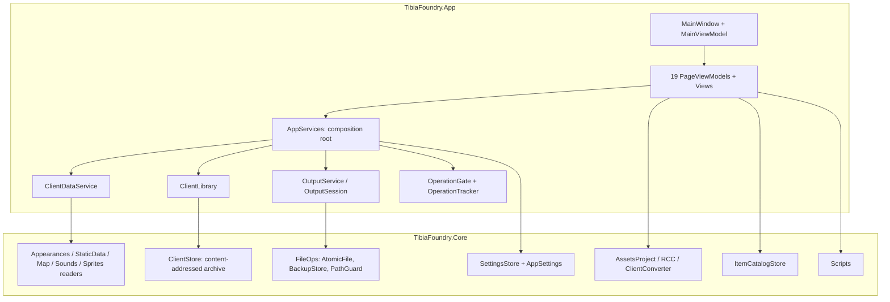

# 01 Overview and Architecture

## Purpose

Tibia Foundry is a Windows desktop application for working with the data of the Tibia game client. Its main uses are:

- Browsing and exporting appearances, static data, maps, houses and sounds.
- Editing assets and Qt `.rcc` files.
- Converting the client's assets to the legacy `Tibia.dat`/`Tibia.spr` format.
- Keeping an item catalog.
- Archiving installed clients and rebuilding them.
- Running file utility scripts.

The application works locally. Only a few optional operations use the network: the TibiaWiki item list, NPC trade data and test-server downloads. *(Verified: `HttpFetcher` is the only place in Core that uses the network.)*

## Solution

| Project | Role | Size (C#) |
|---|---|---|
| `TibiaFoundry.Core` | Data readers and writers, the client store, catalogs, scripts, settings, diagnostics. Has no WPF dependency. | 126 files, ~25.9k lines |
| `TibiaFoundry.App` | WPF shell, pages (MVVM), services, themes, dialogs | 89 C# + 35 XAML files, ~17.5k lines (C#) |
| `TibiaFoundry.Tests` | xUnit v3 tests | 51 files, ~13.4k lines |

These projects are not part of `TibiaFoundry.slnx`:

- `tools/verification/measure`;
- `tools/verification/tibiawiki_import_check`.

**Target and frameworks:** `net10.0-windows`, x64. The App uses CommunityToolkit.Mvvm source generators (284 `[RelayCommand]`, 431 `[ObservableProperty]`). *(Verified)*

**Declared types:** 454 classes, 146 records, 82 enums, 12 record structs, 4 interfaces, 1 struct and 1 delegate.

## Layers

## Start-up (`App.OnStartup`)

1. Logging and crash handlers start.
2. Settings are loaded. This step includes migration to format 7, the legacy import, and recovery from corrupt files.
3. The theme is applied.
4. `AppServices` is created.
5. `ClientStartup` chooses the client that is in use. Depending on the settings it remembers the last choice, asks, or runs the launch check of monitored installations.
6. The main window opens.

The command-line switches `--ui-snapshot` and `--self-test` run headless verification modes and then exit.

## Page model

- **Registry:** `BuiltInTools.Pages` holds one `PageRegistration` for each page, built from a `ToolManifest` (id, type, operations, inputs and outputs, dependencies, license, limitations).
- **Views:** `PageTemplates` maps each view-model to its view through a DataTemplate.
- **Code-behind:** contains view concerns only, such as multi-selection, drag and drop, and double-click.

## Operation pipeline

Long work runs through `PageViewModel.RunAsync`. The pipeline:

- takes a slot from `OperationGate` (a concurrency limit set in Settings → Performance);
- records the operation in `OperationTracker`, which the Diagnostics page shows;
- reports progress and supports cancellation;
- turns `DataFileException` and other failures into status messages and log entries.

Output that may overwrite files goes through `OutputSession`. It applies the File safety settings: ask, replace, keep both or skip, with optional backups.
